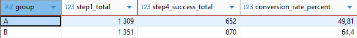
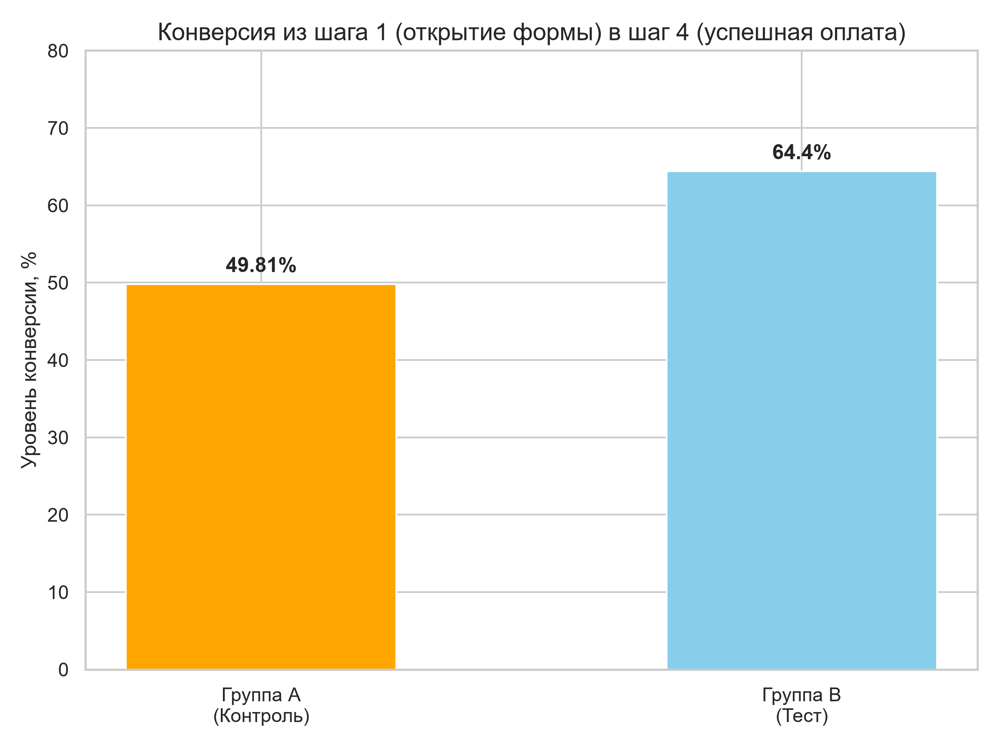

# Анализ результатов A/B-теста новой формы оплаты ЖКХ

## 📌 Стек
- SQL
- Python (statsmodels, numpy, matplotlib)

## 📌 Бизнес-контекст
Сервис по оплате жилищно-коммунальных услуг (ЖКХ) стремится увеличить долю успешных транзакций. В ходе работы была выдвинута гипотеза, что сложный процесс ввода реквизитов на этапе оформления платежа приводит к оттоку пользователей.
Для решения этой проблемы была разработана новая форма оплаты с автозаполнением реквизитов.

## 📌Цель и задачи
**Цель**: оценить влияние новой формы оплаты на целевую метрику (конверсию) и принять решение о целесообразности ее внедрения для всех пользователей.

**Задачи**:

* подготовить данные и очистить их от аномалий,
* рассчитать целевую метрику для контрольной и тестовой груп,
* провести проверку статистических гипотез,
* сформулировать бизнес-рекомендацию.

## 📌 Подготовка и очистка данных
В рамках разведочного анализа данных были найдены аномалии. Среди них: 
* анонимные платежи, 
* пользователи с некорректным возрастом; 
* для некоторых пользователей выявлена одновременная принадлежность к обеим группам в разных таблицах (приоритет отдан группе, указанной в таблице users).

Был сформирован запрос для подсчёта конверсий обеих групп без учёта аномалий, полученные результаты на рисунке 1. Видно, что **разница** в конверсиях значительная: **14,59 пунктов**.

    
    

        Рис. 1. Сводная таблица результатов A/B-теста
    

## 📌 Визуализация результатов

Наглядно результаты представлены на рисунке 2.

    
    

        Рис. 2. Сравнение конверсии из шага 1 в шаг 4 между группами А и В
    

## 📌 Статистическая проверка гипотез
Для проверки значимости результатов были выдвинуты две гипотезы.  
*	**H_0**: разницы в конверсии между формами нет,  
* **H_1**: новая форма статистически значимо увеличивает конверсию.

Использован **Z-тест** для двух конверсий, потому что целевая метрика основана на бинарных событиях, а размер выборки в обеих группах велик (>1000), что позволяет использовать нормальное приближение согласно центральной предельной теореме.
Результаты теста:  
* **|Z-статистика|** = 7.602 (наблюдаемая разница находится на значительном удалении от нуля),  
*	**p-value** < 0.001.
Так как p-value значительно меньше критического уровня α=0.05, нулевая гипотеза отвергается. Разница в конверсиях является статистически значимой.

## 📌 Вывод
На основе данных **рекомендуется внедрить** новую форму оплаты с автозаполнением реквизитов на 100% пользователей.
Изменение дает статистически доказанный прирост конверсии на 14.6 пунктов, **относительный прирост равен 29%**, что напрямую увеличит долю успешных транзакций.

## 📌 Структура репозитория
* `ab_analyse.py` — скрипт с построением картинок и статистическим анализом
* `Script_ab_test.sql` - скрипт с поиском конверсий
* `dataset.xlsx` — исходный датасет
* res_in_pict — папка с графиками
